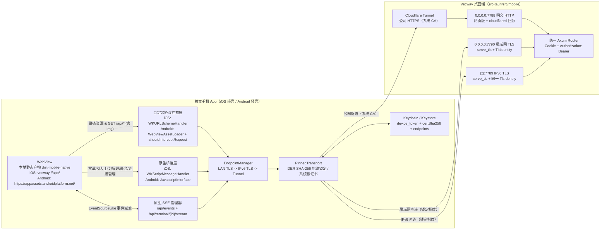

# Vecway 独立手机 App（iOS 优先 / Android 后续）工程设计与工作树落地方案

> 本文档面向独立工作树（推荐 `.worktrees/mobile-app`，分支 `omp/mobile-app`）直接开工实施。所有文件路径、端口、结构体、路由与约束均对齐当前代码库（`docs/ARCHITECTURE.md`、`docs/MOBILE_PRD.md`、`docs/MOBILE_DESIGN.md`、`src-tauri/src/mobile/`、`src-mobile/`）。

---

## 1. 已确定的产品与技术决策

| 维度 | 决策 | 依据与边界 |
|---|---|---|
| **平台顺序** | **先做 iOS App，后续再做 Android APK** | 两者共享同一套前端打包产物与原生桥接契约，Android 按对称结构直接复用。 |
| **手机网页版策略** | **完整保留并持续维护现有手机网页版** | 保留 `0.0.0.0:7788` 局域网明文 HTTP、`cloudflared` 隧道（回源本地 `mobile_port`）和 `[::]:7789` IPv6 HTTPS；**不做 HTTP 应用层自研加解密**。 |
| **前端复用策略** | **独立轻外壳打包 `src-mobile` 静态产物** | 网页版 / iOS App / Android APK 共用同一套 `src-mobile`（React 19 + TS + Tailwind v4），不重写 UI，不把桌面 Rust 后端编进手机 App。 |
| **传输安全策略** | **局域网独立 TLS 端口 + 证书指纹锁定（Cert Pinning）** | 复用桌面端现有 `src-tauri/src/mobile/tls.rs` 自签名证书能力到局域网 TLS 端口（默认 `7790`）。App 扫码配对获取局域网 TLS 地址、一次性配对码与证书 SHA-256 指纹（及可选 IPv6 / Tunnel 备选地址），后续全部走标准 TLS，严格禁止降级到明文 HTTP。 |
| **远程通道兼容** | **自动兼容 IPv6 直连 TLS 与 Cloudflare Tunnel HTTPS** | 局域网 TLS 与 IPv6 TLS 均校验锁定证书指纹；Cloudflare Tunnel 走系统根证书校验，三者共享同一设备令牌与 API 契约。 |

### 当前代码库移动端底座现状（基线盘点）

- **桌面端监听与证书**：
  - `src-tauri/src/mobile/mod.rs`：当前有两个监听实例——`SERVER`（`0.0.0.0:<mobile_port>`，默认 `7788`，明文 HTTP，同时作为 `tunnel_origin()` 给 `cloudflared` 回源）和 `IPV6_SERVER`（`[::]:<mobile_ipv6_port>`，默认 `7789`，`IPV6_V6ONLY=true`，走 `server::serve_tls`）。
  - `src-tauri/src/mobile/tls.rs`：基于 `rcgen` + `rustls` + `tokio-rustls` 生成自签名证书并持久化到 `data_dir()/mobile-tls/`（目录 `0700`，`key.der` 通过 `key.der.tmp` + `0600` + `rename` 原子落盘；`cert.der`、`meta.json` 目前为直接写入）。`compute_fingerprint` 计算**叶子证书 DER 的 SHA-256**，格式为冒号分隔大写十六进制（`AA:BB:…`，共 95 字符）。`required_sans` 仅包含 `["localhost", "127.0.0.1", "::1"]` 及可选 `ddns_hostname`，**不含动态局域网 IPv4**。
  - `src-tauri/src/mobile/auth.rs`：`COOKIE = "ompws_token"`，`PAIRING_TTL_MINUTES = 5`；`token_from_headers` **已经**优先解析 `Authorization: Bearer <token>` 再回退 `Cookie`；令牌以 SHA-256 哈希存于 SQLite `mobile_devices` 表，撤销通过 `REVOCATIONS` 广播即时断开 SSE。
  - `src-tauri/src/mobile/server.rs`：所有 `/api/*` 经过 `require_auth`；所有非 `GET/HEAD/OPTIONS` 请求及 `POST /pair` 均经过 `verify_csrf`（校验 `Sec-Fetch-Site`、`Origin`/`Referer` 与 `Host` + scheme 一致）；`POST /pair` 当前 JSON 模式只返回 `204` + `Set-Cookie`，尚未返回 JSON 设备令牌。
  - `src-tauri/src/mobile/camera.rs`：独立的临时局域网 HTTP 拍照接收器（桌面端点击“手机拍照”时拉起，ephemeral 端口、10 分钟 TTL、不共享工作台凭据）。
- **移动端前端（`src-mobile`）**：
  - `vite.mobile.config.ts`：`base: "/static/"`，输出到 `src-tauri/mobile-dist/`（由 `assets.rs` 嵌入 Release 二进制），路由完全基于 `location.hash`（`src-mobile/core/nav.ts`），无需服务端 SPA fallback。
  - 网络出口集中但有 **4 处易遗漏点**：
    1. `src-mobile/core/api.ts`：`fetch(apiUrl(path), { credentials: "same-origin" })` + `upload()`（原始二进制体 ≤ 20 MiB）；
    2. `src-mobile/core/sse.ts`：`new EventSource("/api/events")`（已抽象 `EventSourceLike` 与 `SseDeps.create`）；
    3. `src-mobile/features/panels/TerminalPage.tsx`（L122）：**直接调用** `new EventSource(apiUrl(\`/terminal/${id}/stream\`))`，未走 `sse.ts`；
    4. `src-mobile/features/chat/components/useVoiceInput.ts`（L55、L98）：依赖 `navigator.mediaDevices.getUserMedia`（需要安全上下文）并**直接调用** `fetch(apiUrl("/voice/transcribe"))`；
    5. `` 直连鉴权媒体接口：`TurnView.tsx`（`/api/sessions/{id}/image?path=...`）、`IdeasPage.tsx`（`/api/ideas/image?path=...`）以及 `Markdown.tsx` 中的 `/api/...`。

---

## 2. 核心架构与技术难点拆解（避免踩坑）

### 2.1 整体架构图



### 2.2 难点 1：本地前端 + 自签名 HTTPS 后端通信难题

**为什么不能让 WebView 直接 `fetch("https://192.168.x.y:7790/api/...")`？**

1. **ATS 与系统 TLS 拦截**：iOS `WKWebView` 内核级强制校验证书链与域名/IP SAN，不会把自签名证书的 `fetch`/`EventSource` 交给页面忽略；且 `tls.rs` 的证书刻意不包含动态局域网 IPv4 SAN。
2. **跨源与 Cookie 不可靠**：本地加载的页面（`file://` 或自定义 scheme）请求 `https://<lan-ip>:<port>` 属于跨源请求，会触发 CORS 预检、SameSite/ITP Cookie 拦截，且 `` 标签无法附加 `Authorization: Bearer` 头。
3. **`localStorage` 绑定域名漂移**：网页版每次电脑换 Wi-Fi 换局域网 IP 都会变成新 origin，丢失 `ompm.prefs` 和 Cookie；本地托管方案将前端固定在稳定 origin（iOS `vecway://app/`、Android `https://appassets.androidplatform.net/`），彻底消除换 IP 丢配置问题。

**推荐分层通信方案（避免踩坑的混合传输）**：

| 流量类型 | iOS 实现 | Android 实现 | 设计原因 |
|---|---|---|---|
| **静态资源**（`index.html`、`assets/*`） | `WKURLSchemeHandler` 托管 `vecway://app/` | `WebViewAssetLoader` 托管 `https://appassets.androidplatform.net/` | `src-mobile` 相对路径零改动；hash 路由 `#/s/:id` 原生工作；`VisualizeBlock` 的 `srcDoc` sandbox iframe 与 `postMessage` 不受影响。 |
| **`GET /api/*` 与 ``** | `WKURLSchemeHandler` 拦截 `/api/*`，转交 `PinnedTransport` 自动加 `Authorization: Bearer` | `shouldInterceptRequest` 拦截 `/api/*`，转交 OkHttp `PinnedTransport` 自动加 `Authorization: Bearer` | ``、`/api/ideas/image`、Markdown 相对图片全部**零改动可用**。 |
| **写请求与大文件上传（`POST/PUT/PATCH/DELETE`，≤ 20 MiB）** | 通过 `WKScriptMessageHandler` 走原生 `URLSession` / `URLSessionUploadTask` | 走 `JavascriptInterface` 或 OkHttp（建议与 iOS 统一走桥接或对非流式写请求直走桥接） | **避坑（WebKit 已知缺陷）**：iOS `WKURLSchemeTask.request.httpBody` 在 `fetch` 发送大 `Blob`/文件（如 20 MiB 上传）时可能丢失或为空；走原生桥接可支持大文件上传、真实超时（`UPLOAD_TIMEOUT_MS = 5m`、`LONG_TIMEOUT_MS = 15m`）和取消（`AbortSignal`）。 |
| **所有 SSE 长连接**（`/api/events` 与 `/api/terminal/{id}/stream`） | 原生 `SSEBridge`（`URLSessionDataDelegate` 逐行解析）+ `evaluateJavaScript` 推给 JS | 原生 `SSEBridge`（`okhttp-sse` 独立线程池）+ `evaluateJavascript` 推给 JS | **避坑**：Android `shouldInterceptRequest` 占用 WebView 有限 IO 线程池，阻塞式 SSE 会把页面其它资源卡死；iOS `WKURLSchemeHandler` 对 `EventSource` 重连与缓冲表现不稳定。独立原生 SSE 桥接支持多路并发（主事件流 + 最多 4 路终端 PTY 流）。 |
| **语音录音**（`useVoiceInput.ts`） | 原生 `AVAudioRecorder` 桥接（录 `audio/mp4` 直传 `/api/voice/transcribe`） | 原生安全上下文下 Web `MediaRecorder` 可用，亦可复用同一桥接接口 | **避坑**：iOS `WKWebView` 自定义 scheme（`vecway://`）下 `window.isSecureContext === false`，会导致 `useVoiceInput.ts` L55 直接报“当前环境不支持录音”。 |

### 2.3 难点 2：鉴权模型与 CSRF 边界（防 403 踩坑）

1. **网页版不变**：继续使用 `HttpOnly; SameSite=Lax; Max-Age=31536000` Cookie（`ompws_token`，HTTPS 下带 `; Secure`）。
2. **独立 App 令牌策略**：
   - 认证头：`Authorization: Bearer <device_token>`。
   - **安全隔离**：`device_token` 明文**仅保存在 iOS Keychain / Android Keystore**，由原生网络层统一注入请求头，**绝不写入 `localStorage`、不透传给前端 JS 变量**，避免第三方 Markdown/渲染漏洞造成凭据外泄。
3. **CSRF 陷阱与双保险修复**：
   - 现状：`src-tauri/src/mobile/server.rs` 中 `verify_csrf` 对所有写请求与 `POST /pair` 校验 `Origin`/`Referer` 是否与 `Host` + scheme 匹配。
   - **坑点**：若原生代理将 WebView 产生的 `Origin: vecway://app` 或 `Origin: https://appassets.androidplatform.net` 原样转发到 `Host: 192.168.1.10:7790`，服务端会直接返回 `403 Origin 来源不受信任`。
   - **双保险方案**：
     - **客户端（原生层）**：转发到桌面端时一律**剥离** `Origin`、`Referer`、`Cookie`、`Sec-Fetch-*` 请求头；设置可识别的 `User-Agent`（如 `Vecway-iOS/0.2.0 (iPhone)`、`Vecway-Android/0.2.0 (Android)`），兼容桌面端 `auth::default_device_name` 的平台识别（`iPhone`/`iPad`/`Android`）。
     - **服务端（`server.rs`）**：在 `require_auth` 中区分认证来源——**通过 `Authorization: Bearer` 认证且未携带认证 Cookie 的请求，不要求浏览器同源 `Origin`/`Referer`**（仍拦截显式 `Sec-Fetch-Site: cross-site`）；通过 Cookie 认证的浏览器请求继续严格执行 `verify_csrf`。
4. **配对换取令牌的安全边界**：
   - `POST /pair` 扩展 JSON 字段 `returnToken?: boolean`（默认 `false`）。
   - 当 `returnToken == true` 时，服务端**强制校验当前连接为 HTTPS**（`tls_ext.is_some()` 或可信代理的 `x-forwarded-proto: https`），否则拒绝并返回 `403`——确保明文局域网 HTTP 永远不会以 JSON 响应体明文下发设备令牌。
   - 校验通过后兑换一次性配对码，返回 `200 OK`、`Cache-Control: no-store`、`{ "token": "<32B base64url>", "device": MobileDevice }`（不写 `Set-Cookie`）。

### 2.4 难点 3：多通道自动选路、Wi-Fi 换 IP 与证书变更处理

#### 通道优先级与校验策略

| 优先级 | 通道 | 地址示例 | TLS 校验模式 |
|---|---|---|---|
| 1 | **局域网直连 TLS** | `https://192.168.1.10:7790` | **严格指纹锁定**：提取服务端叶子证书 DER 计算 SHA-256，与 Keychain/Keystore 中保存的 `certSha256` 恒定时间比对；跳过系统 CA 链与 IP SAN 校验（因为动态局域网 IP 不在 SAN 中）。 |
| 2 | **IPv6 直连 TLS** | `https://ddns.example:7789` 或 `https://[240e:...]:7789` | **严格指纹锁定**（与局域网共享同一 `TlsIdentity` 指纹）；如主机为 DDNS 域名，同样以锁定指纹为准。 |
| 3 | **Cloudflare Tunnel HTTPS** | `https://xxx.trycloudflare.com` 或命名域名 | **系统根证书校验**（标准 TLS + 域名校验，禁止使用自定义跳过 CA 的客户端）。 |
| — | ~~局域网明文 HTTP~~ | ~~`http://192.168.1.10:7788`~~ | **App 端硬禁止**：解析或选路遇到 `http://` 一律拒绝，防止任何降级攻击。 |

#### 选路与切换机制（`EndpointManager`）

- **快速探活**：使用轻量 `GET /api/device`（带 `Authorization: Bearer`）探活；LAN TLS 给短连接超时（如 `1.5s`），避免在外出 5G 环境下长时间卡顿；LAN 不可达时并行探测已配置的 IPv6 TLS 与 Tunnel HTTPS，优先选择已连通且优先级更高的通道。
- **动态地址同步**：任一受信任通道（例如外网 Tunnel 或 IPv6）连通后，调用 `GET /api/left/settings` 读取最新 `mobile.lanTlsUrl` / `mobile.ipv6Url` / `mobile.tunnelUrl` 自动更新候选地址列表。
  - **铁律**：绝不允许通过服务端返回接口自动静默覆盖客户端本地锁定的 `certSha256`！
- **桌面换 Wi-Fi 换局域网 IP 应对**：
  1. 若已配置 Tunnel / IPv6：App 自动回退远程通道，并通过 `GET /api/left/settings` 无感拿到新的 `lanTlsUrl`，下次回到同 Wi-Fi 自动恢复局域网直连；
  2. 纯局域网用户：在 App 「连接与设备」页提供**手动修改 IP/端口**与**重新扫码更新地址**（同指纹时无需重新配对，直接复用既有设备令牌）；
  3. **可选增强（M5）**：桌面端广播 mDNS/Bonjour（`_vecway._tcp.local.`，TXT 仅发布 `port=<lanTlsPort>&fp8=<指纹前8位>`），App 同局域网自动发现新 IP，建立连接时仍强制校验完整的 256-bit `certSha256`。

#### 证书指纹不匹配（防 MITM 攻击）

当触发以下任一情况导致服务端叶子证书 DER SHA-256 与本地锁定值不一致时：
- 桌面端被重装或 `data_dir()/mobile-tls/` 被清空；
- 桌面端变更了 `ddns_hostname` 触发 `tls::ensure_tls_identity` 重签证书；
- 局域网存在中间人劫持（MITM）。

**强制行为**：
1. `PinnedTransport` 立即中止 TLS 握手并抛出结构化错误 `PinMismatchError(expected, actual)`；
2. **禁止自动回退到其它未核验通道，禁止提供“忽略风险继续连接”按钮**；
3. 弹出高辨识度阻断界面，并列展示「已信任指纹（前 8 位…后 8 位）」与「当前服务端指纹（前 8 位…后 8 位）」，引导用户在电脑「设置 → 连接与设备」核对指纹后**重新扫码配对**。

---

## 3. 桌面端改造清单（精确到文件与契约）

### 3.1 `src-tauri/src/mobile/tls.rs`

- **保持证书稳定性**：`required_sans` 继续仅包含 `["localhost", "127.0.0.1", "::1"]` + 可选 `ddns_hostname`，**切勿将局域网 IPv4 写入 SAN**，否则桌面切换 Wi-Fi 换 IP 会导致证书重签、所有已配对 App 触发指纹失配。
- **原子落盘补强**：当前 `write_private_key` 已做到 `key.der.tmp`（0600）→ `rename`；补充将 `cert.der` 和 `meta.json` 也改为同目录临时文件 + `rename`（且先写 `key.der`、再写 `cert.der`、最后写 `meta.json`），消除异常中断导致的半写文件。
- **共享单一 `TlsIdentity`**：LAN TLS 与 IPv6 TLS 均调用 `ensure_tls_identity(ddns_host.as_deref())`，保证同一台电脑对外展示唯一的 `cert_sha256`。若用户更新 `ddns_hostname` 导致证书重签，需在重启 IPv6 监听时同步重载 LAN TLS 监听（或提供统一的 `reload_tls_listeners` 内部辅助函数），避免两个监听持有不同指纹。

### 3.2 `src-tauri/src/mobile/mod.rs` & `src-tauri/src/settings.rs`

- **端口与配置（`src-tauri/src/contracts.rs` `Settings` + `src-tauri/src/settings.rs` 校验）**：
  - 新增 `#[serde(default = "default_mobile_lan_tls_port")] pub mobile_lan_tls_port: u16`，默认 **`7790`**（与现有 `mobile_port = 7788`、`mobile_ipv6_port = 7789` 对齐）。
  - 校验规则：`mobile_lan_tls_port >= 1024`，且与 `mobile_port`、`mobile_ipv6_port` 互不相等。
- **独立局域网 TLS 监听（`mod.rs`）**：
  - 新增静态句柄 `static LAN_TLS_SERVER: Mutex<Option<TlsRunning>>`（与 `IPV6_SERVER` 复用同一结构体，含 `port`、`shutdown`、`cert_sha256`、`cert_hostname`）。
  - **为什么不直接把 `IPV6_SERVER` 改成双栈 `[::]:7789`？** 因为 `IPV6_SERVER` 绑定公网 IPv6 受 `mobile_ipv6_enabled` 开关控制；独立 `LAN_TLS_SERVER` 绑定 `0.0.0.0:<mobile_lan_tls_port>`，让只用局域网的用户在不暴露公网 IPv6 的前提下即可启用加密 App 连接。
  - 在 `start_internal` 中：先启动明文 `SERVER`（`0.0.0.0:<mobile_port>`），随即获取 `tls::ensure_tls_identity` 并在 `0.0.0.0:<mobile_lan_tls_port>` 启动 `server::serve_tls`（复用现有完全一致的连接数上限 `MAX_CONNECTIONS=64`、握手超时 `5s`、读头超时 `10s` 与优雅排空 `3s`）。
  - 在 `stop` 中：依次停止 `tunnel`、`IPV6_SERVER`、`LAN_TLS_SERVER`、`SERVER`。
  - 在 `status(state)` 中：
    - 填充 `lan_tls_running`、`lan_tls_port`、`lan_tls_url: lan_tls_port.map(|p| format!("https://{}:{p}", lan_ip()))`；
    - `cert_sha256` 优先取活跃的 `LAN_TLS_SERVER` 或 `IPV6_SERVER` 所服务的真实证书指纹（不再仅在 IPv6 开启时才有值）。

### 3.3 `src-tauri/src/mobile/server.rs`、`auth.rs` & `api/left.rs`

- **`src-tauri/src/mobile/auth.rs`**：
  - 现状 `token_from_headers` 已支持 `Authorization: Bearer <token>`；重构返回值为明确区分来源的枚举，例如：
    ```rust
    pub enum AuthSource {
        Bearer(String),
        Cookie(String),
    }
    pub fn auth_from_headers(headers: &axum::http::HeaderMap) -> Option<AuthSource>
    ```
  - 保留 `token_from_headers` 兼容封装（调用 `auth_from_headers`）以免影响现有测试。
- **`src-tauri/src/mobile/server.rs`**：
  - `require_auth`：若为 `AuthSource::Cookie`，所有非 `GET/HEAD/OPTIONS` 严格执行 `verify_csrf`；若为 `AuthSource::Bearer`（且请求未携带认证 Cookie），仅拒绝显式 `Sec-Fetch-Site: cross-site`，不因缺失或不同 `Origin` 误拒原生客户端。
  - `PairQuery` 增量添加 `#[serde(default, rename = "returnToken")] return_token: bool`：
    - 当 `json && q.return_token` 时：
      - 校验 `https`（`tls_ext.is_some()` 或 `x-forwarded-proto == https`），否则返回 `ApiError(StatusCode::FORBIDDEN, "App 令牌配对仅允许通过 HTTPS/TLS 连接".into())`；
      - 兑换成功后查询 `auth::device_for_token(&db, &token)`，返回 `(StatusCode::OK, [(header::CACHE_CONTROL, "no-store")], Json(json!({ "token": token, "device": device })))`（不设 `Set-Cookie`）。
    - 当 `return_token == false`（默认）：100% 保持现有网页版 `204 + Set-Cookie` / `303 + Set-Cookie` 行为。
- **`src-tauri/src/mobile/api/left.rs`**：
  - `settings_summary`（`GET /api/left/settings`）在 `mobile` 对象中增量附加：
    - `lanTlsRunning: status.lan_tls_running`
    - `lanTlsPort: status.lan_tls_port`
    - `lanTlsUrl: status.lan_tls_url`
    - `certSha256: status.cert_sha256`（仅用于 UI 展示核对，客户端不得用于静默替换锁定值）。

### 3.4 `src-tauri/src/contracts.rs`、`src/lib/contracts.ts` & 配对二维码载荷

- **`MobileStatus`（Rust + TS 同步增量扩展，向后兼容）**：
  ```rust
  // src-tauri/src/contracts.rs -> MobileStatus 新增字段
  pub lan_tls_running: bool,
  pub lan_tls_port: u16,
  pub lan_tls_url: Option<String>,
  // 已有 pub cert_sha256: Option<String>（改为 LAN TLS 或 IPv6 TLS 任一运行即有值）
  ```
- **配对二维码载荷设计（推荐「一码双用 + 向后兼容」）**：
  - `PairingInfo` 保持现有字段 `url`、`qr_svg`、`expires_at` 不变，可选增量返回 `cert_sha256: Option<String>` 与 `app_url: Option<String>`（供桌面端 `MobilePanel.tsx` 展示指纹或提供「App 专用码」切换）。
  - **默认二维码内容（一码双用，浏览器与 App 通吃）**：
    ```text
    http://192.168.1.10:7788/pair?code=<32B_code>#app=<base64url(json)>
    ```
    其中 `<json>` 使用紧凑字段名控制二维码密度（总长通常 240–340 字节，QR Version 11–13 扫码极快）：
    ```json
    {
      "v": 1,
      "lt": "https://192.168.1.10:7790",
      "fp": "AA:BB:CC:...:FF",
      "v6": "https://ddns.example:7789",
      "tn": "https://xxx.trycloudflare.com"
    }
    ```
    - **网页浏览器扫码**：直接打开 `http://192.168.1.10:7788/pair?code=...`（HTTP 规范下 `#app=...` 片段不会发往服务端，现有 `pair_page` 与网页配对零改动）。
    - **独立 App 内扫码**：解析 `code` 与 `#app=` JSON，**完全忽略前缀明文 `http://`**，直接按 `lt`（若 `PairingTarget::Tunnel`/`Ipv6` 则优先对应通道）建立证书指纹锁定 TLS 连接，调用 `POST /pair`（`{"code": "...", "returnToken": true}`）换取设备令牌。
  - **可选补充（系统相机直拉 App）**：M3 可在桌面端 `MobilePanel.tsx` 增加「独立 App 扫码」视图，生成 `vecway://pair?v=1&code=<code >&lt=...&fp=...`（支持 iOS/Android 系统相机扫码直接拉起已安装 App）。

### 3.5 相机与文件上传通道整理

- **App 内聊天/侧聊/灵感拍照与文件上传**：`Composer.tsx`、`HomePage.tsx`、`SidechatPage.tsx`、`IdeasPage.tsx` 全部复用现有 `POST /api/sessions/{id}/upload?name=...`（≤ 20 MiB）与 `POST /api/ideas/image`（≤ 20 MiB），自动走主 TLS 通道（`0.0.0.0:7790` / IPv6 TLS / Tunnel），无需额外明文相机端口。
- **桌面端发起的“手机拍照传图”（`src-tauri/src/mobile/camera.rs`）**：现有临时隔离 LAN HTTP 接收器保留给未安装 App 的手机浏览器使用；未来若希望已配对 App 直接承接桌面拍照二维码，可在主 TLS 路由器增量挂载 `POST /api/camera/{capture_id}/photos` 复用 `camera.rs` 内部存储，同样无需明文端口。

---

## 4. 移动端前端（`src-mobile`）最小适配层

目标：**业务页面（`features/*`、`ui/*`）基本零改动**，全部环境差异收口到构建配置与极薄桥接层。

### 4.1 构建模式扩展（`vite.mobile.config.ts` & `package.json`）

- 现有 `pnpm build:mobile` 行为 **100% 不变**：`base: "/static/"`、`outDir: "src-tauri/mobile-dist"`、包含 `sw.ts` → `sw.js`。
- 新增原生构建模式（`MOBILE_TARGET=native`）：
  - `package.json` 新增脚本：`"build:mobile:native": "MOBILE_TARGET=native vite build --config vite.mobile.config.ts"`；
  - `vite.mobile.config.ts` 根据 `process.env.MOBILE_TARGET === "native"` 切换：
    - `base: "./"`（确保在 `vecway://app/` 和 `https://appassets.androidplatform.net/` 下均能正确加载 `assets/*`）；
    - `build.outDir`: `dist-mobile-native`（避免污染桌面端 `rust-embed` 读取的 `src-tauri/mobile-dist/`）；
    - `rollupOptions.input`: 仅保留 `index`（移除 `sw` 入口，原生 WebView 不注册 Service Worker）；
    - `define`: `{ __MOBILE_NATIVE_BUILD__: JSON.stringify(isNative) }`。

### 4.2 运行时桥接层 `src-mobile/core/nativeBridge.ts`

由原生外壳在 `WKUserScript`（`atDocumentStart`）/ Android `WebView` 注入 `window.__VECWAY_NATIVE__`，前端通过 `src-mobile/core/nativeBridge.ts` 统一访问：

```ts
export type NativePlatform = "ios" | "android";

export interface NativeEndpointStatus {
  paired: boolean;
  activeChannel: "lan_tls" | "ipv6_tls" | "tunnel" | null;
  activeUrl: string | null;
  certSha256: string | null;
  candidates: { lanTls?: string; ipv6?: string; tunnel?: string };
}

export interface NativeHttpRequest {
  id: string;
  method: string;
  path: string;            // 相对路径，如 "/api/sessions"
  headers?: Record<string, string>;
  bodyBase64?: string;     // JSON 文本或二进制上传体（大文件可改为分片/临时句柄）
  timeoutMs?: number;
}

export interface NativeHttpResponse {
  status: number;
  headers: Record<string, string>;
  bodyBase64: string;
}

export interface NativeBridge {
  readonly platform: NativePlatform;
  readonly appVersion: string;

  // 1. 传输层（供 api.ts、sse.ts、TerminalPage.tsx 使用）
  httpRequest(req: NativeHttpRequest, signal?: AbortSignal): Promise<NativeHttpResponse>;
  openSse(url: string, handlers: {
    onOpen?: () => void;
    onEvent: (type: string, data: string) => void;
    onError: (message?: string) => void;
  }): () => void; // 返回 close()

  // 2. 配对与连接管理（供 main.tsx、ConnectionBanner.tsx、ConnectionSheet.tsx 使用）
  getConnectionStatus(): Promise<NativeEndpointStatus>;
  openPairScanner(): Promise<{ ok: boolean; error?: string }>;
  updateEndpoints(endpoints: Partial<NativeEndpointStatus["candidates"]>): Promise<NativeEndpointStatus>;
  reprobeConnection(): Promise<NativeEndpointStatus>;
  unpair(): Promise<void>;

  // 3. 设备能力（按需）
  audio?: {
    startRecording(): Promise<void>;
    stopAndTranscribe(): Promise<{ text: string }>; // 原生录完直接走 PinnedTransport 上传 /api/voice/transcribe
    cancelRecording(): Promise<void>;
  };
  push?: {
    getStatus(): Promise<{ supported: boolean; permission: "default" | "granted" | "denied"; registered: boolean }>;
    enable(): Promise<void>;
    disable(): Promise<void>;
  };
}
```

### 4.3 `src-mobile` 最小改动点清单

| 文件 | 改动内容 | 对网页版影响 |
|---|---|---|
| `src-mobile/core/nativeBridge.ts`（新建） | 检测 `window.__VECWAY_NATIVE__`，导出 `isNativeApp()`、`getNativeBridge()` 与统一 `createEventSource(url)` 工厂 | 网页版 `isNativeApp() === false`，零开销 |
| `src-mobile/core/api.ts` | `send()` 在原生模式（至少 iOS 写请求与 `upload()`）委托给 `bridge.httpRequest`；保留既有 `ApiError`、401 置 `unauthorized` 与超时/中止语义 | 网页版逻辑完全不变 |
| `src-mobile/core/sse.ts` | `EventSourceLike` 补充可选 `onopen?: (() => void) | null`；`startEvents()` 使用 `createEventSource("/api/events")` | 网页版仍返回 `new EventSource(url)` |
| `src-mobile/features/panels/TerminalPage.tsx` | L122 将 `new EventSource(apiUrl(...))` 改为 `createEventSource(apiUrl(...))` | 网页版行为完全等价 |
| `src-mobile/features/chat/components/useVoiceInput.ts` | 若 `bridge?.audio` 存在则走原生录音转写；否则将 L98 原始 `fetch` 收敛为复用 `api.ts` 传输 | 网页版继续走 `MediaRecorder` |
| `src-mobile/main.tsx` | 原生模式启动时跳过 URL `?pair=` 解析，先查 `bridge.getConnectionStatus()`；未配对时直接展示扫码引导页，已配对则照常 `startEvents()` + `refresh()` | 网页版启动序列不变 |
| `src-mobile/app/ConnectionBanner.tsx` | 401 `unauthorized` 状态下，原生模式将「重新配对」动作直接绑定 `bridge.openPairScanner()` | 网页版保留文字指引弹层 |
| `src-mobile/features/settings/sheets/ConnectionSheet.tsx` | 原生模式下不显示无意义的 `vecway://app` 作为 `location.origin`，改为展示当前活跃通道、锁定证书指纹摘要、「重新扫码 / 手动更新局域网 IP / 解除配对」操作 | 网页版保持原布局 |
| `src-mobile/features/settings/sheets/NotifySheet.tsx` & `push.ts` | 原生模式下隐藏“添加到主屏幕”的 Safari PWA 提示，接入 `bridge.push`（M3 初期无 APNs 时清晰提示当前版本暂未开启原生推送，不展示误导性浏览器报错） | 网页版 Web Push 流程不变 |

---

## 5. iOS 轻外壳工程设计

### 5.1 技术选型对比：为什么选纯 Swift 轻壳？

| 维度 | **纯 Swift (`WKWebView`) 轻壳（推荐）** | Capacitor | Tauri Mobile (`tauri ios`) |
|---|---|---|---|
| **TLS 证书指纹锁定可控度** | **最高**：直接写标准 `URLSessionDelegate`，逐字节比对叶子证书 DER SHA-256，与 `tls.rs` 100% 对齐 | 中：需自写原生 Swift 插件绕过 `WKWebView` 限制，仍要自己写 `WKURLSchemeHandler` + `URLSessionDelegate` | 偏重：跨 Rust/Swift 边界维护成本高，仍需解决 WebView 侧自定义协议与 SSE |
| **包体与编译链路** | **极轻**：仅 Xcode + Swift，无 Node 插件同步层、无 Rust iOS 交叉编译工具链 | 中：引入 Capacitor CLI + 插件生态与版本升级耦合 | 重：需给 `src-tauri` 做桌面/移动条件编译拆分（当前 `src-tauri` 深度依赖 `portable-pty`、`notify`、`system-configuration`、`local-ip-address` 等桌面 crate） |
| **原生 SSE & 20 MiB 上传桥接** | **直接透明**：几百行 Swift 即可实现 `SSEBridge` + `URLSessionUploadTask`，排障零黑盒 | 需穿透 Capacitor Bridge 序列化层，处理流式 SSE 和大二进制仍需自定义原生代码 | 需在 Rust/Swift 之间再封一层 IPC |
| **六个月可维护性** | **最优**：目录独立在 `apps/ios/`，零第三方 Pod/SPM 依赖（全苹果系统框架），不影响主仓桌面构建 | 需持续跟随 Capacitor 大版本与第三方扫码/Keychain 插件兼容 | 与桌面端 `Cargo.toml` 强耦合，容易互相拖累构建 |

结论：Vecway 的手机端定位就是**远程控制台客户端**，不需要把桌面后端搬进手机。用纯 Swift 轻壳（全系统框架 `WebKit`、`Foundation`、`Security`、`AVFoundation`、`Network`，**零第三方依赖**）是最无聊、最可控、长期维护成本最低的工程选择。

### 5.2 推荐目录结构（`apps/ios/`）

建议采用 **XcodeGen (`project.yml`)** 生成 `.xcodeproj`（或在 git 中提交精简 `.xcodeproj`），避免工作树并行开发时 `project.pbxproj` 冲突：

```text
apps/ios/
├── project.yml                         # XcodeGen 工程描述（Bundle ID、最低 iOS 16.0、能力开关）
├── scripts/
│   └── sync-web.sh                     # 执行 pnpm build:mobile:native 并拷贝 dist-mobile-native -> Resources/WebBundle
└── Vecway/
    ├── Info.plist                      # 权限说明、URL Scheme (vecway://)、严格 ATS
    ├── App/
    │   ├── VecwayApp.swift             # SwiftUI App 入口、处理 vecway://pair 回调、监听前后台切换通知前端 resync
    │   └── RootView.swift              # 根视图（未配对引导页 / AppWebView / 扫码 Modal / 指纹失配阻断页）
    ├── Web/
    │   ├── AppWebView.swift            # WKWebView 封装、注入 window.__VECWAY_NATIVE__、安全区与键盘适配、外链跳 Safari
    │   ├── AppSchemeHandler.swift      # WKURLSchemeHandler 托管 vecway://app/ 静态资源 + 转发 GET /api/* (含 )
    │   └── BridgeRouter.swift          # WKScriptMessageHandler 路由 JS <-> Native 调用与回调 Promise 管理
    ├── Network/
    │   ├── PinnedTransport.swift       # 双 URLSession：PinnedSession（DER SHA-256 锁定）与 SystemSession（Tunnel）
    │   ├── SSEBridge.swift             # 独立 URLSessionDataDelegate，解析 SSE 帧并支持 /api/events + 多路 terminal 流
    │   └── EndpointManager.swift       # LAN TLS -> IPv6 TLS -> Tunnel 选路、探活、状态通知（可选 NWBrowser Bonjour）
    ├── Security/
    │   ├── KeychainStore.swift         # SecItem 存储 deviceToken、pinnedCertSha256、endpoints（禁止 iCloud 备份）
    │   └── PairingPayload.swift        # 解析 #app= 与 vecway://pair 二维码载荷，严格校验 https:// 与 SHA-256 格式
    ├── Scanner/
    │   └── QRScannerView.swift         # AVFoundation 二维码扫描 + 配对确认/指纹展示 + 调用 POST /pair (returnToken=true)
    ├── Audio/
    │   └── NativeVoiceRecorder.swift   # AVAudioRecorder 录音并直传 /api/voice/transcribe
    └── Resources/
        └── WebBundle/                  # 构建产物（.gitignore 忽略，由 sync-web.sh 生成）
```

### 5.3 核心实现细节要点

1. **`PinnedTransport` 证书指纹校验（必须与 `src-tauri/src/mobile/tls.rs:96` 字节级一致）**：
   - 在 `urlSession(_:didReceive:completionHandler:)` 中读取 `challenge.protectionSpace.serverTrust`；
   - 通过 `SecTrustCopyCertificateChain(trust)` 取索引 `0` 的叶子证书 `SecCertificate`；
   - `let der = SecCertificateCopyData(leafCert) as Data`；
   - 用 `CryptoKit.SHA256.hash(data: der)` 计算 32 字节摘要，与本地保存的 32 字节期望摘要做**恒定时间比较**；
   - 仅当严格相等时调用 `completionHandler(.useCredential, URLCredential(trust: trust))`，否则调用 `.cancelAuthenticationChallenge` 并向外抛出 `PinMismatchError`（记录双方指纹供 UI 提示）。
   - **严禁**将 `PinnedSession` 用于 Tunnel 域名；Tunnel 域名固定走系统默认 `URLSession`（无自定义 `serverTrust` 覆写）。
2. **`AppSchemeHandler` 安全边界**：
   - 仅允许读取 `WebBundle` 目录规范化路径内的文件（防路径穿越）；
   - 拦截 `/api/*` 时只接受当前 App 已配对状态，自动剥离 `Origin`/`Referer`/`Cookie`/`Sec-Fetch-*`，注入 `Authorization: Bearer <token>`；
   - 外部链接（`http://` / `https://` 非 `vecway://app/`）在 `WKNavigationDelegate` 中通过 `UIApplication.shared.open` 交给系统 Safari 打开，绝不在内部 WebView 加载不可信网页。
3. **`Info.plist` 必要权限与安全声明**：
   - `NSCameraUsageDescription`：「用于扫描电脑端配对二维码及在对话中拍照上传图片」
   - `NSPhotoLibraryUsageDescription`：「用于在对话与灵感中选择图片上传」
   - `NSMicrophoneUsageDescription`：「用于语音转文字输入」
   - `NSLocalNetworkUsageDescription`：「用于在同一 Wi-Fi 局域网内通过加密连接访问电脑上的 Vecway 服务」
   - `NSBonjourServices`（启用自动发现时添加）：`["_vecway._tcp"]`
   - `CFBundleURLTypes`：注册 `vecway` URL Scheme（用于 `vecway://pair?...`）
   - **ATS**：不配置 `NSAllowsArbitraryLoads = true`；应用层硬校验目标端点必须以 `https://` 开头。

---

## 6. Android APK 轻外壳工程设计（预留对称结构）

Android 端在 iOS 跑通后直接落地，**100% 复用相同的 `dist-mobile-native` 构建产物与 `src-mobile/core/nativeBridge.ts` 协议**，两端目录与模块严格对称：

```text
apps/android/
├── settings.gradle.kts
├── build.gradle.kts
├── scripts/
│   └── sync-web.sh                     # 执行 pnpm build:mobile:native 并拷贝至 app/src/main/assets/web
└── app/
    ├── build.gradle.kts                # minSdk 26 (Android 8.0+), targetSdk 35, OkHttp + okhttp-sse + CameraX + MLKit/ZXing
    └── src/main/
        ├── AndroidManifest.xml         # android:allowBackup="false"、networkSecurityConfig、权限声明
        ├── res/xml/network_security_config.xml  # <base-config cleartextTrafficPermitted="false" />
        ├── assets/web/                 # 构建产物（.gitignore 忽略）
        └── java/dev/vecway/mobile/
            ├── MainActivity.kt         # WebView 宿主、系统返回键优先派发 history.back()、文件选择器回调、前后台 resync
            ├── web/
            │   ├── AppWebViewClient.kt # WebViewAssetLoader (https://appassets.androidplatform.net/) + /api/* GET 拦截
            │   ├── AppChromeClient.kt  # onShowFileChooser 显式支持拍照 Intent + 多选相册、麦克风权限回调
            │   └── BridgeInterface.kt  # @JavascriptInterface 实现与 iOS 完全一致的 bridge RPC 协议
            ├── network/
            │   ├── PinnedTransport.kt  # 双 OkHttpClient：Pinned（自定义 X509TrustManager + HostnameVerifier 比对 DER SHA-256）vs System（Tunnel）
            │   ├── SseBridge.kt        # okhttp-sse 独立调度器，绝不阻塞 WebView IO 线程
            │   └── EndpointManager.kt  # LAN TLS -> IPv6 TLS -> Tunnel 选路（可选 NsdManager mDNS 发现）
            ├── security/
            │   ├── KeystoreStore.kt    # Android Keystore AES-GCM 加密存储 token + certSha256 + endpoints
            │   └── PairingPayload.kt   # 与 iOS 完全一致的 #app= / vecway://pair 解析校验
            └── scanner/
                └── QrScannerActivity.kt # CameraX 扫码与配对确认
```

**Android 特有注意事项**：
- `WebViewAssetLoader` 将本地资源映射到 `https://appassets.androidplatform.net/`，因此 Android WebView 内 `window.isSecureContext === true`，`useVoiceInput.ts` 的 `getUserMedia` 可直接工作（需在 `WebChromeClient.onPermissionRequest` 中校验 origin 严格等于 `https://appassets.androidplatform.net` 后放行 `RESOURCE_AUDIO_CAPTURE`）。
- 必须设置 `android:allowBackup="false"` 及 `cleartextTrafficPermitted="false"`，在系统层面封死备份导出令牌与明文 HTTP 降级。
- 系统返回键需与 `src-mobile/core/nav.ts` 的 hash history 栈联动：先判断 `webView.canGoBack()` 执行 `webView.goBack()`，仅在栈底时退出或退至后台。

---

## 7. iOS 签名与装机方案决策表

> 在启动 M3 真机装机前，用户按实际使用方式从以下三种路线择一即可（开发调试阶段无需提前付费）。

| 方案 | 费用 | 签名有效期与装机方式 | 原生后台推送（APNs） | 适用场景 | 主要限制 |
|---|---|---|---|---|---|
| **① 付费 Apple Developer 账号** | **$99 / 年** | **长期有效**（TestFlight 每版 90 天，无插线烦恼；支持多台设备 / 团队内测 / App Store 上架） | **支持**（可接入完整 APNs 锁屏推送） | 长期日常主力自用、多设备或对外分发 | 需年费并完成苹果开发者实名审核 |
| **② 免费个人 Apple ID 插线自装** | **$0** | **7 天有效**（Xcode 插线安装；到期需连 Mac 重签，或配合 SideStore/AltStore 自动续签） | **不支持**（苹果免费 Personal Team 不开放 Push Notifications 能力） | **M3 阶段零成本验证**、个人短期体验 | 每 7 天重签、同账号最多签 3 个 App、无 APNs 推送 |
| **③ 先出 Android APK，后补 iOS** | **$0** | **永久有效**（本地 keystore 签名生成 `.apk`，任意安卓手机直接安装升级） | 可选（本地前台服务 / FCM） | 手头有安卓机、希望零年费先长期用上独立 App | 暂无法在 iPhone 上原生安装（iPhone 可继续用现有网页版） |

**建议路径**：
- **开发验证期（M1 → M3）**：先用**免费个人 Apple ID + iOS 模拟器 + 插线真机**把桌面 LAN TLS、前端适配与 iOS 轻壳全部跑通验收，零前置费用；
- **日常使用决策点**：M3 验收满意后，若确定 iPhone 长期日常使用或需要锁屏 APNs 推送，再升级 **① 付费 Apple Developer 账号**；若暂不打算付年费，则保持免费自签或推进 **M4 Android APK**。

---

## 8. 新工作树落地路线与验收清单

### 8.1 创建独立工作树（避免与主工作树冲突）

```bash
# 在主仓库根目录执行
git worktree add .worktrees/mobile-app -b omp/mobile-app
cd .worktrees/mobile-app

# 安装依赖
pnpm install

# 如需并行运行桌面端调试，使用独立端口与数据目录，避免冲突主实例（参考 docs/ARCHITECTURE.md）
VITE_PORT=1426 OMPWS_DATA_DIR="$HOME/.vecway-mobile-app-dev" pnpm dev:preview
```

### 8.2 分阶段实施里程碑

#### M1：桌面端 LAN TLS + Bearer 配对扩展 + 兼容二维码载荷
- **目标**：桌面端开启手机服务即同时提供明文 HTTP（网页版/隧道回源）与自签名 LAN TLS（App 专用），支持 HTTPS 下的 JSON 令牌兑换与一码双用二维码。
- **改动文件**：
  - `src-tauri/src/mobile/tls.rs`（`cert.der`/`meta.json` 原子写、稳定指纹复用）
  - `src-tauri/src/mobile/mod.rs`（新增 `LAN_TLS_SERVER` 生命周期管理、`status()` 输出 `lan_tls_*` 与统一 `cert_sha256`、`create_pairing()` 拼接 `#app=` 载荷）
  - `src-tauri/src/mobile/auth.rs`（`AuthSource` 区分 Bearer 与 Cookie）
  - `src-tauri/src/mobile/server.rs`（`require_auth` 区分 Bearer/Cookie CSRF、`POST /pair` 扩展 `returnToken: true` 且强制 HTTPS）
  - `src-tauri/src/mobile/api/left.rs`（`GET /api/left/settings` 增量输出 `lanTlsRunning`/`lanTlsPort`/`lanTlsUrl`/`certSha256`）
  - `src-tauri/src/contracts.rs`、`src-tauri/src/settings.rs`、`src/lib/contracts.ts`（`mobile_lan_tls_port` 默认 `7790`、`MobileStatus` 增量字段）
  - `src/features/mobile/MobilePanel.tsx`（展示 LAN TLS 地址与证书 SHA-256 指纹，供用户核对）
- **阶段验收**：`cargo test mobile` 覆盖 LAN TLS 监听、明文 HTTP 拒发 `returnToken`、HTTPS 下发 `token` + Bearer 访问 + 撤销即时断流、网页版原有测试全绿。

#### M2：`src-mobile` 原生构建模式与极薄桥接层
- **目标**：产出独立的 `dist-mobile-native/` 静态包，全部网络/SSE/录音/配对/连接状态通过 `nativeBridge.ts` 可插拔切换，网页版构建零回归。
- **改动文件**：
  - `vite.mobile.config.ts`、`package.json`（新增 `MOBILE_TARGET=native` 与 `build:mobile:native`）
  - `src-mobile/core/nativeBridge.ts`（新建）
  - `src-mobile/core/api.ts`、`src-mobile/core/sse.ts`、`src-mobile/main.tsx`
  - `src-mobile/features/panels/TerminalPage.tsx`、`src-mobile/features/chat/components/useVoiceInput.ts`
  - `src-mobile/app/ConnectionBanner.tsx`、`src-mobile/features/settings/sheets/ConnectionSheet.tsx`、`src-mobile/features/settings/sheets/NotifySheet.tsx`
- **阶段验收**：`pnpm tsc --noEmit`、`pnpm test`、`pnpm build:mobile` 与 `pnpm build:mobile:native` 全部通过；新增针对 `nativeBridge.ts` mock 注入的单元测试（含 401 停试、SSE 重连、终端流、语音原生分支）。

#### M3：iOS 轻外壳实现、联调与安全验收
- **目标**：完成 `apps/ios/` 全部核心模块，在 iOS 模拟器与真机（免费 Apple ID 插线即可）完整跑通 Vecway 移动端工作流。
- **核心交付**：`apps/ios/` 工程、`sync-web.sh`、`PinnedTransport`、`SSEBridge`、`EndpointManager`、`AppSchemeHandler`、`BridgeRouter`、`KeychainStore`、`QRScannerView`、`NativeVoiceRecorder`。
- **阶段验收**：完成下方第 8.3 节全部安全、功能与网页版回归验收项。

#### M4：Android APK 轻外壳复用落地
- **目标**：按第 6 节对称结构实现 `apps/android/`，复用同一 `dist-mobile-native` 与 `nativeBridge.ts` 协议，输出签名 Release APK。
- **阶段验收**：在 Android 真机完成同口径功能与安全验收（含 `cleartextTrafficPermitted="false"` 与 `allowBackup="false"` 核验）。

#### M5（可选增强）：原生推送与局域网零配置发现
- **范围**：
  - 桌面端可选广播 Bonjour/mDNS `_vecway._tcp.`，配合 iOS `NWBrowser` / Android `NsdManager` 自动跟踪换 Wi-Fi 后的局域网 IP；
  - 若启用付费 Apple Developer 账号，再扩展原生推送（桌面端新增 `POST /api/push/register-native`，结合轻中继或自托管 APNs/FCM 凭证发送锁屏通知，复用现有 `push.rs` 的 `SseGuard` 与 `PRESENCE` 前台静默逻辑）。

---

### 8.3 验收清单

#### A. 安全验收（任一项失败即阻断发布）
- [ ] **错误证书指纹硬阻断**：修改本地锁定指纹任意 1 字符，或重启桌面端替换 `mobile-tls/cert.der`，App 必须立即拒绝连接并展示指纹对比阻断页，**界面不存在“忽略/继续连接”按钮**。
- [ ] **明文降级硬阻止**：手动填入或通过二维码伪造 `http://` 地址作为端点时，App 在解析与发包两层均直接拒绝，抓包确认无任何携带 `Authorization: Bearer` 的明文 TCP 流量。
- [ ] **明文配对拒发令牌**：向 `http://<lan>:7788/pair` 发送 `{"code":"...","returnToken":true}` 必须返回 `403` 且不消耗/不泄露令牌；向 `https://<lan>:7790/pair` 发送同一请求返回 `200` 与 `{token, device}`。
- [ ] **凭据不暴露给 WebView 存储**：检查 `WKWebView` / Android `WebView` 的 `localStorage`、`sessionStorage` 与 `document.cookie`，确认不包含明文 `device_token`。
- [ ] **实时撤销生效**：在桌面端「设置 → 连接与设备」撤销该 App 设备后，App 当前 `/api/events` 与 `/api/terminal/{id}/stream` 在秒级内断开，后续请求返回 `401`，App 立即停止重试并展示「重新扫码配对」按钮。
- [ ] **CSRF 防护无回退**：浏览器 Cookie 模式下跨站 `Origin` 请求依然返回 `403`；原生 App 请求剥离 `Origin`/`Referer` 后所有 `POST/PUT/PATCH/DELETE`（发消息、审批、提交 Git、保存设置）均正常返回 `2xx`。

#### B. 核心功能验收（iOS 真机 / 模拟器 & 后续 Android）
- [ ] **一码双用**：同一桌面配对二维码，用 iOS 相机/Safari 打开可正常走网页版配对；用独立 App 扫码直接走 LAN TLS 完成配对并进入首页。
- [ ] **多通道自动切换**：同 Wi-Fi 下命中「局域网 TLS」；关闭手机 Wi-Fi 切至蜂窝网络后自动切换到「IPv6 TLS」或「Cloudflare Tunnel」；重新连回 Wi-Fi 后切回「局域网 TLS」。
- [ ] **核心代理工作流**：新建/切换会话、中文 IME 打字流畅、流式输出与 `rAF` 合批、工具审批与澄清问答、规划模式、子代理树与详情、Mermaid 缩放与 `VisualizeBlock` 交互小部件全部正常。
- [ ] **媒体与双向实时流**：拍照/相册/文件上传（含大图片与多文件 ≤ 20 MiB）、聊天与灵感图片 `` 正常加载、原生录音转文字成功、交互式终端（含多 Tab 与辅助按键栏）输出与输入正常。
- [ ] **前后台恢复**：切后台锁屏超过 1 分钟后回到前台，SSE 自动重连并触发 `resync` 拉齐最新消息，无假在线或死链。

#### C. 手机网页版零回归验收
- [ ] `pnpm build:mobile` 产出 `src-tauri/mobile-dist/` 结构与 `/static/`、`/sw.js` 不受 `build:mobile:native` 影响。
- [ ] 局域网 `http://<lan>:7788`、Cloudflare Tunnel、IPv6 HTTPS 网页版配对、聊天、上传、终端、Web Push 均正常。
- [ ] 桌面端独立手机拍照（`mobile_camera_start` / `camera.rs`）扫码上传回归正常。
- [ ] 仓库自动化检查（`pnpm tsc --noEmit`、`pnpm test`、`cargo test`）全部通过。
